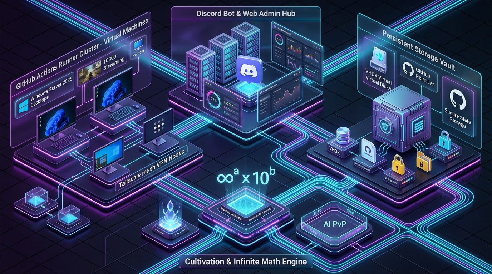
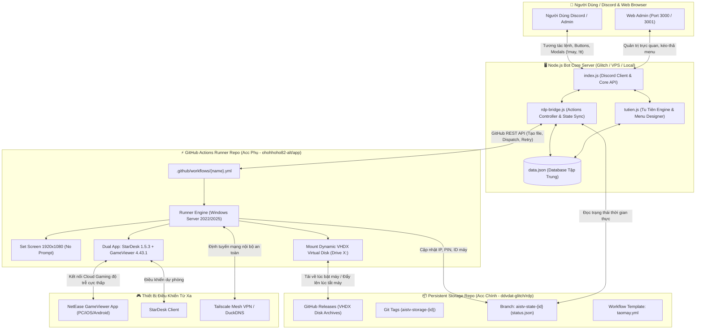

<div align="center">

# 🚀 BÁ ĐẠO DISCORD BOT & CLOUD RDP ECOSYSTEM
### Hệ Sinh Thái Quản Trị Máy Ảo Windows Đám Mây, Trình Thiết Kế Menu Đa Tầng & Hệ Thống Tu Tiên



[](https://nodejs.org/)
[](https://discord.js.org/)
[](https://github.com/features/actions)
[](https://gameviewer.netease.com/)
[](https://stardesk.net/)
[](LICENSE)

---
</div>

## 📑 Mục Lục
- [1. Tổng Quan & Sơ Đồ Kiến Trúc Hệ Thống](#1-tổng-quan--sơ-đồ-kiến-trúc-hệ-thống)
- [2. Cụm Máy Ảo RDP & Cloud Gaming (Kiến Trúc 2-Repo Độc Quyền)](#2-cụm-máy-ảo-rdp--cloud-gaming-kiến-trúc-2-repo-độc-quyền)
  - [Mô hình 2-Repo & Phân luồng Token](#mô-hình-2-repo--phân-luồng-token)
  - [Cơ chế Ổ đĩa Ảo VHDX Vĩnh Cửu & Roaming Session](#cơ-chế-ổ-đĩa-ảo-vhdx-vĩnh-cửu--roaming-session)
  - [Dual App Remote & Tự Động Thiết Lập Độ Phân Giải 1080p](#dual-app-remote--tự-động-thiết-lập-độ-phân-giải-1080p)
- [3. Hệ Thống Tu Tiên & Trình Thiết Kế Menu Siêu Rộng (Cổng 3001)](#3-hệ-thống-tu-tiên--trình-thiết-kế-menu-siêu-rộng-cổng-3001)
  - [Trình Thiết Kế Menu Đa Hành Động (Canva-like Designer)](#trình-thiết-kế-menu-đa-hành-động-canva-like-designer)
  - [Động Cơ Tính Toán Số Vô Hạn $\infty^a \times 10^b$](#động-cơ-tính-toán-số-vô-hạn-infty-a-times-10b)
  - [Đấu Trường PvP Uy Áp & Tường Thuật AI Ollama](#đấu-trường-pvp-uy-áp--tường-thuật-ai-ollama)
- [4. Discord Bot Core & Web Admin Quản Trị (Cổng 3000)](#4-discord-bot-core--web-admin-quản-trị-cổng-3000)
- [5. Hướng Dẫn Cài Đặt & Khởi Chạy](#5-hướng-dẫn-cài-đặt--khởi-chạy)
- [6. Bảng Tra Cứu Toàn Bộ Lệnh Discord](#6-bảng-tra-cứu-toàn-bộ-lệnh-discord)
- [7. Kỹ Thuật Chuyên Sâu & Xử Lý Sự Cố (Troubleshooting)](#7-kỹ-thuật-chuyên-sâu--xử-lý-sự-cố-troubleshooting)

---

## 1. Tổng Quan & Sơ Đồ Kiến Trúc Hệ Thống

Dự án là một hệ sinh thái toàn diện kết hợp giữa **Discord Bot đa nhiệm**, **Bảng điều khiển Web Quản trị thời gian thực**, và **Cụm máy ảo đám mây Windows Server** tự động hóa hoàn toàn thông qua **GitHub Actions CI/CD**.



---

## 2. Cụm Máy Ảo RDP & Cloud Gaming (Kiến Trúc 2-Repo Độc Quyền)

### Mô hình 2-Repo & Phân luồng Token
Nhằm tối ưu hóa thời gian tính toán miễn phí (free compute minutes) và bảo vệ dữ liệu tuyệt đối, hệ thống tách rời thành **2 Repository riêng biệt**:

1. **Storage Repo (Repo Lưu Trữ Gốc - Acc Chính: `ddvdat-glitch/rdp`)**:
   - Chịu trách nhiệm bảo quản vĩnh cửu các file ổ đĩa ảo `.vhdx` thông qua GitHub Releases.
   - Quản lý trạng thái máy ảo qua các nhánh Git `aistv-state-{machine_id}` độc lập.
   - Chứa file template chuẩn [`taomay.yml`](file:///c:/Users/acc/Downloads/badao/taomay.yml).
2. **Runner Repo (Repo Treo Máy - Acc Phụ: `ohohhoho82-alt/app`)**:
   - Chuyên dụng để chạy tiến trình GitHub Actions Windows Runner tiêu tốn CPU/RAM/Giờ chạy.
   - Bot tự động khởi tạo file workflow `.github/workflows/{machine_id}.yml` riêng biệt cho từng máy ảo.

> [!IMPORTANT]
> **Quy Chuẩn Cấu Hình Token Cho 2 Repo:**
> - **Runner PAT Token (`PAT_TOKEN`)**: Token cấp cho Bot Discord có quyền `repo` và `workflow` trên **Repo Treo Máy** để tạo file `.yml` và trigger Actions.
> - **Storage Secret Token (`STORAGE_GH_TOKEN`)**: Secret cài đặt trong *Settings > Secrets and variables > Actions* của **Repo Treo Máy** chứa PAT có quyền ghi vào **Repo Lưu Trữ Gốc** để upload ổ đĩa VHDX.

---

### Cơ chế Ổ đĩa Ảo VHDX Vĩnh Cửu & Roaming Session
- Khi máy ảo được kích hoạt: Workflow tự động kiểm tra tag `aistv-storage-{machine_id}` trên Repo Gốc. Nếu đã có bản lưu, workflow sẽ kéo toàn bộ tệp `.vhdx` về và mount trực tiếp vào hệ thống dưới dạng ổ đĩa riêng `X:\`.
- Khi người dùng gửi lệnh tắt máy hoặc hết thời lượng (1h, 3h, 5h00m): Tiến trình ngầm giải phóng ổ đĩa, nén tệp VHDX và upload đè bản mới nhất lên GitHub Release.
- **SID Cleanup & Roaming DPAPI**: Bot tích hợp script PowerShell tự động chuẩn hóa Security Identifier (SID) và sao lưu thư mục `DPAPI MasterKey` của Windows, giúp **duy trì trạng thái đăng nhập vĩnh viễn** của tài khoản NetEase GameViewer và trình duyệt Chrome mà không bị mất phiên giữa các lần bật/tắt.

---

### Dual App Remote & Tự Động Thiết Lập Độ Phân Giải 1080p
Mỗi máy ảo khi khởi tạo được trang bị đồng thời cả 2 giải pháp điều khiển từ xa hàng đầu:
1. **NetEase GameViewer 4.43.1**: Giải pháp Cloud Gaming độ trễ siêu thấp, hỗ trợ truyền hình ảnh 60FPS/2K, tự động gán mã PIN ngẫu nhiên hoặc cố định, giải mã ID trực tiếp qua file `config.db` nội bộ của GameViewer.
2. **StarDesk 1.5.3**: Giải pháp Remote Desktop dự phòng tốc độ cao.
3. **Auto 1080p Full HD Resolution**: Workflow tích hợp script Windows API `User32.dll:ChangeDisplaySettings` tự động ép độ phân giải màn hình ảo về **1920x1080** ngay khi khởi động dịch vụ mà **không hiển thị bảng xác nhận (confirmation dialog)**, giải quyết triệt để lỗi màn hình bị kẹt ở tỷ lệ vuông 1024x768.

---

## 3. Hệ Thống Tu Tiên & Trình Thiết Kế Menu Siêu Rộng (Cổng 3001)

Hệ thống Tu Tiên được thiết kế như một MMORPG text-based chuyên sâu, chạy song song tại cổng **http://localhost:3001** (cùng tiến trình, đọc ghi đồng bộ với `data.json`).

### Trình Thiết Kế Menu Đa Hành Động (Canva-like Designer)
- **Xem trước thời gian thực (WYSIWYG)**: Giao diện trực quan mô phỏng 100% cách hiển thị trên ứng dụng Discord (cả bản Desktop lẫn Mobile).
- **Kéo - Thả Tự Do (Drag & Drop)**: Dễ dàng sắp xếp các Action Rows, Buttons, Embeds, Select Menus.
- **Chuỗi Tiến Trình Đa Hành Động (Multi-Action Pipeline)**: Cho phép một nút bấm thực hiện tuần tự nhiều thao tác: Chạy script $\rightarrow$ Chuyển menu $\rightarrow$ Bật/Tắt máy ảo $\rightarrow$ Gửi thông báo ẩn (Ephemeral).
- **Điều Kiện Hiển Thị Nút (Conditional Visibility)**: Thiết lập điều kiện nút bấm chỉ xuất hiện khi người chơi đạt cảnh giới yêu cầu, là chủ sở hữu máy ảo, hoặc có quyền Admin Discord.
- **Thư Viện Biến Động Đa Năng**:
  - Máy ảo: `{onlineCount}`, `{offlineCount}`, `{totalCount}`, `{runnerRepo}`, `{storageRepo}`, `{machineList}`, `{curMachineId}`, `{curDisplayName}`, `{curStatusBadge}`, `{curGvId}`, `{curDisplayPin}`, `{curStardeskId}`.
  - Tu tiên: `{user}`, `{realm}`, `{tier}`, `{exp}`, `{curHp}`, `{maxHp}`, `{atk}`, `{def}`, `{spd}`, `{dao}`, `{equipped}`.

---

### Động Cơ Tính Toán Số Vô Hạn $\infty^a \times 10^b$
File thư viện [`infnum.js`](file:///c:/Users/acc/Downloads/badao/temp_repo/infnum.js) giải quyết giới hạn tràn số `Number.MAX_SAFE_INTEGER` của JavaScript thông thường:
- Lưu trữ chỉ số dưới dạng cặp số `[a, b]` đại diện cho giá trị $\infty^a \times 10^b$.
- Phân tầng 19 Cảnh Giới: Bắt đầu từ *Phàm Nhân*, vượt qua *Luyện Khí*, *Trúc Cơ*... đến *Luyện Khí Hóa Thần* ($10^{1,000,001}$), và từ *Luyện Thần Hoàn Hư* trở lên mỗi cảnh giới nhảy 1 tầng vô hạn $\infty^a$.
- Tầng $\infty$ cao hơn áp đảo tuyệt đối tầng dưới (đòn tấn công từ tầng dưới hoàn toàn không thể chạm tới).

---

### Đấu Trường PvP Uy Áp & Tường Thuật AI Ollama
- **Uy Áp Tất Sát**: Hai người chơi tỉ thí chênh lệch từ 1 cảnh giới trở lên, kẻ cảnh giới cao chỉ cần xuất uy áp là đối phương lập tức hồn phi phách tán, không cần giao chiến.
- **Tường Thuật Trận Đấu Bằng AI**: Khi 2 người chơi cùng cảnh giới giao tranh, bot tự động tính toán diễn biến và gửi dữ liệu tới mô hình ngôn ngữ lớn (Ollama AI) để tự động viết nên bài văn tường thuật giao tranh hiệp khách sống động.

---

## 4. Discord Bot Core & Web Admin Quản Trị (Cổng 3000)

- **Web Dashboard Trực Quan**: Mở tại **http://localhost:3000**, cho phép cấu hình lệnh tùy chỉnh, thẻ tag, danh sách quyền role/thành viên trực tiếp vào `data.json` mà không cần khởi động lại bot.
- **Bộ Giải Đố Tự Động "Vua Tiếng Việt"**: Tự động giải mã câu đố hoán vị ký tự tiếng Việt dạng `c/ò/n/l/n/h/h/ạ/g` dựa trên từ điển nén đa cấp (`Viet11K.txt`, `Viet22K.txt`, `Viet39K.txt`, `Viet74K.txt`).
- **Phân Cấp Quyền Hạn Đa Tầng**: So sánh cấp bậc vai trò người gửi lệnh và người bị tác động (Mute, Kick, Ban, Gán Role) chống lạm quyền.
- **Live Proxy Messaging**: Gửi tin nhắn và phản hồi tin nhắn trực tiếp qua tài khoản Bot từ giao diện Web.

---

## 5. Hướng Dẫn Cài Đặt & Khởi Chạy

### Yêu Cầu Môi Trường
- **Node.js**: Phiên bản 18.x trở lên.
- **Git**: Đã cài đặt trên máy chủ.
- **Tài khoản Discord Developer**: Đã bật **MESSAGE CONTENT INTENT** và **SERVER MEMBERS INTENT**.
- **GitHub Personal Access Token (PAT)**: Token có quyền `repo` và `workflow`.

### Các Bước Cài Đặt
1. **Clone mã nguồn về máy**:
   ```bash
   git clone https://github.com/ddvdat-glitch/botcuadat.git
   cd botcuadat
   ```

2. **Cài đặt thư viện**:
   ```bash
   npm install
   ```

3. **Cấu hình tệp môi trường `.env`**:
   Tạo file `.env` từ `.env.example`:
   ```ini
   # Token bí mật của Discord Bot
   DISCORD_TOKEN=MTE5...your_bot_token_here

   # Mật khẩu quản trị Dashboard Web
   ADMIN_PASSWORD=2008

   # Cổng Web Quản trị Bot & RDP Manager
   PORT=3000

   # Cổng Web Quản trị Hệ Thống Tu Tiên & Menu Designer
   TUTIEN_PORT=3001

   # Cấu hình GitHub (Tùy chọn nạp trước)
   STORAGE_REPO=ddvdat-glitch/rdp
   RUNNER_REPO=ohohhoho82-alt/app
   PAT_TOKEN=ghp_...
   ```

4. **Khởi chạy hệ thống**:
   ```bash
   npm start
   ```

5. **Truy cập giao diện Web**:
   - Trang quản trị chính & RDP Manager: `http://localhost:3000` (hoặc domain DuckDNS/Tailscale của bạn).
   - Trang thiết kế Menu & Tu Tiên: `http://localhost:3001`.

---

## 6. Bảng Tra Cứu Toàn Bộ Lệnh Discord

### 🖥️ Nhóm Lệnh Quản Trị Máy Ảo RDP (`!may`)

| Lệnh | Tham số | Mô tả chi tiết |
| :--- | :--- | :--- |
| `!may` / `!may menu` | *Không* | Mở **Menu Bảng Điều Khiển Tương Tác** với nút bấm và giao diện chọn máy |
| `!may ds` | *Không* | Xem danh sách toàn bộ máy ảo, trạng thái Online/Offline, thời gian còn lại |
| `!may tao` | `<tên> [thời_lượng] [pin]` | Khởi tạo máy ảo mới (VD: `!may tao dat 5h00m 12345678`) |
| `!may chay` | `<tên>` | Kích hoạt phiên chạy mới cho máy ảo đã có |
| `!may tat` / `!may stop` | `<tên>` | Lưu ổ đĩa VHDX lên Repo Gốc và tắt máy an toàn |
| `!may restart` | `<tên>` | Khởi động lại máy ảo (hủy phiên cũ và tạo phiên mới) |
| `!may xoao` / `!may reset` | `<tên>` | **Xóa ổ đĩa VHDX trên GitHub Release** để lần sau máy tạo ổ đĩa mới tinh |
| `!may xoamay` / `!may del` | `<tên>` | Xóa toàn bộ file workflow `.yml` và dữ liệu của máy khỏi hệ thống |
| `!may token` | `<pat_token>` | Cài đặt GitHub PAT Token dùng chung cho bot |
| `!may runnertoken` | `<pat_token>` | Cài đặt PAT Token riêng cho **Repo Treo Máy** (Acc Phụ) |
| `!may storagetoken` | `<pat_token>` | Cài đặt PAT Token riêng cho **Repo Lưu Trữ Ổ Đĩa** (Acc Chính) |
| `!may doirepo` | `<owner/repo> [token]` | Chuyển đổi nơi treo máy Actions sang repository mới |
| `!may capquyen` | `<@user hoặc ID>` | Cấp quyền điều khiển máy ảo cho thành viên (Chỉ Root Admin) |
| `!may thuhoi` | `<@user hoặc ID>` | Thu hồi quyền sử dụng máy ảo của thành viên |
| `!may dsquyen` | *Không* | Xem danh sách các thành viên và vai trò được phép sử dụng máy ảo |
| `!may config` / `!may info` | *Không* | Xem thông tin chi tiết cấu hình 2-Repo và tình trạng kết nối Token |

---

### ☯ Nhóm Lệnh Tu Tiên (`!tt`)

| Lệnh | Tham số | Mô tả chi tiết |
| :--- | :--- | :--- |
| `!tt` | *Không* | Mở Menu Tu Tiên tương tác chính (Canva Designer) |
| `!ttc` | `[@user]` | Xem bảng thông tin nhân vật, cảnh giới, chỉ số, đạo ngấn |
| `!ttl` | *Không* | Tu luyện tích lũy tu vi (hồi chiêu theo cấu hình) |
| `!ttdp` | *Không* | Tiến hành độ kiếp / đột phá cảnh giới mới |
| `!ttkn` | `[dùng <id> \| bỏ]` | Quản lý và trang bị kỹ năng / thần thông chiến đấu |
| `!ttpk` | `[@user]` | Khiêu chiến người chơi khác (nếu không tag ai sẽ đánh Tâm Ma) |
| `!ttreo` | `[bật \| tắt]` | Bật/tắt chế độ tự động tích lũy tu vi ngoại tuyến |
| `!tttop` | *Không* | Bảng phong thần xếp hạng tu vi toàn server |

---

## 7. Kỹ Thuật Chuyên Sâu & Xử Lý Sự Cố (Troubleshooting)

### 1. Lỗi `Invalid workflow file: dat.yml#L97` (Bad Indentation)
- **Hiện tượng**: GitHub Actions từ chối chạy và báo lỗi cú pháp dòng 97 của file workflow vừa sinh ra.
- **Nguyên nhân**: Khi bot replace chuỗi `STORAGE_REPO:` bằng regex không bao hàm khoảng trắng thụt lề đầu dòng (`^[ \t]*`), làm dòng 97 bị thụt lề 12 khoảng trắng thay vì 6 khoảng trắng chuẩn dưới `env:`.
- **Khắc phục**: Đã chuẩn hóa regex trong hàm `buildVmWorkflow`:
  ```javascript
  out = out.replace(/^[ \t]*STORAGE_REPO:\s*.*$/m, `      STORAGE_REPO: '${storageRepo}'`);
  out = out.replace(/^[ \t]*MACHINE_ID:\s*.*$/m, `      MACHINE_ID: '${cleanId}'`);
  out = out.replace(/^[ \t]*DISPLAY_NAME:\s*.*$/m, `      DISPLAY_NAME: '${dispName}'`);
  ```

---

### 2. Lỗi `Workflow does not have 'workflow_dispatch' trigger`
- **Hiện tượng**: Bot báo lỗi khi vừa nộp modal tạo máy ảo mới.
- **Nguyên nhân**: Khi tạo file mới trên GitHub qua Contents API, hệ thống GitHub Actions mất từ **5 đến 15 giây** để phân tích cú pháp và lập chỉ mục (indexing delay). Gọi lệnh `dispatch` ngay lập tức sẽ bị lỗi do GitHub chưa nhận diện trigger.
- **Khắc phục**: Hàm `dispatchWorkflow` trong [`rdp-bridge.js`](file:///c:/Users/acc/Downloads/badao/temp_repo/rdp-bridge.js) đã tích hợp thuật toán **Exponential Backoff Retry** (thử lại tối đa 6 lần với độ trễ 3s, 5s, 7s, 9s...) và tự động fallback về file template gốc `taomay.yml` nếu cần.

---

### 3. Phân Biệt Tên Secret Giữa Dấu Gạch Ngang `-` Và Gạch Dưới `_`
- GitHub Actions Secret **tuyệt đối không chấp nhận dấu gạch ngang** (`PAT-TOKEN` là không hợp lệ).
- Bắt buộc đặt tên là:
  - `STORAGE_GH_TOKEN`: Token quyền ghi Repo Gốc.
  - `PAT_TOKEN`: Token quyền quản trị Runner Repo.

---

<div align="center">

**BÁ ĐẠO DISCORD BOT ECOSYSTEM** • Phát triển & Tối ưu hóa bởi Đội ngũ Kỹ Thuật AISTV  
*Được thiết kế để vận hành 24/7 bền bỉ và tự động hóa tuyệt đối.*

</div>
